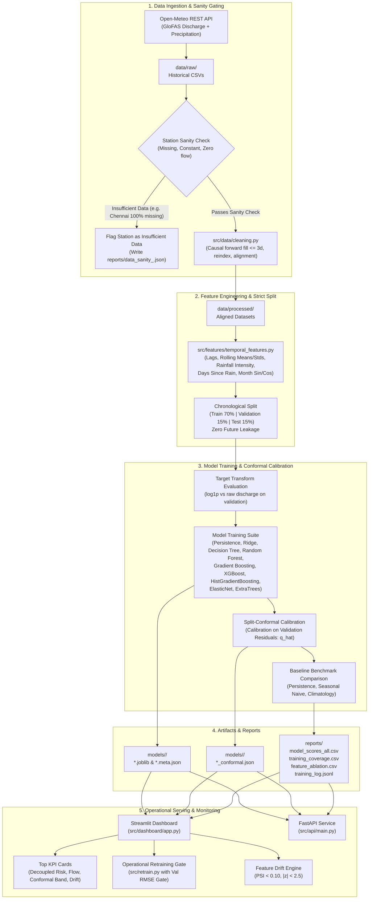

# ClimateShield AI: System Architecture & Data Flow

## 1. System Overview

ClimateShield AI is an academic decision-support prototype for river discharge forecasting across monitored basins in Tamil Nadu, India. The system forecasts modelled daily river discharge ($m^3/s$) for forecast horizons of $h \in \{1, 3, 7\}$ days ahead.

Discharge data is sourced from the Copernicus GloFAS / Open-Meteo modelled hydrological dataset and meteorological precipitation data is sourced from Open-Meteo under CC BY 4.0.

> [!IMPORTANT]
> **Academic Decision-Support Prototype**:
> All discharge figures represent **modelled hydrological runoff**, not physical in-situ river gauge water levels. All risk thresholds are prototype statistical percentiles ($p_{50}, p_{75}, p_{90}$) calculated from historical training sets, not statutory warning stages issued by the Central Water Commission (CWC).

---

## 2. End-to-End Pipeline Architecture

---

## 3. Core Architectural Modules

### 3.1 Data Sanity & Quality Assurance
- **Sanity Checks (`src/train.py`, `src/data/`):**
  Validates each station before training. Stations with zero valid readings, all-zero flows, or large gaps (e.g., Chennai with 100% missing discharge) are cleanly flagged as `insufficient_data` and saved to `reports/data_sanity_<station_id>.json`. The pipeline skips downstream model fitting for these stations without halting the multi-station loop.
- **Causal Cleaning:**
  Missing gaps up to 3 days are forward-filled; longer gaps remain marked as NaN with gap tracking flags to eliminate future-to-past data leakage.

### 3.2 Leakage-Free Temporal Feature Engineering
Features are strictly computed using historical observations available at time $t$:
- **Lags:** Discharge ($t-1, t-2, t-3, t-7, t-14$) and Rainfall ($t, t-1, t-2, t-3, t-7$).
- **Rolling Aggregations:** Rolling means ($3d, 7d, 14d$) and rolling standard deviations ($7d, 14d$).
- **Rainfall Intensity:** Maximum daily rainfall in previous 3 and 7 days.
- **Antecedent Indicators:** Days since significant rainfall ($P \ge 5.0\text{ mm}$), Antecedent Precipitation Index (API).
- **Calendar Encodings:** Sin/Cos transformations of day of year and month.

### 3.3 Target Transformation & Cross-Validation
- **Target Formulation:**
  Evaluates raw discharge versus $\log(1 + y)$ target transformation on the validation set. Inverse transformations ($\exp(y) - 1$) are applied before calculating evaluation metrics.
- **Chronological Splitting:**
  Strict chronological split (70% Train, 15% Validation, 15% Test) ensures temporal integrity. Scalers and imputers are fit exclusively on the training partition.

### 3.4 Conformal Prediction Intervals
- **Methodology:** Split-conformal calibration on validation set absolute residuals:
  $$q_{\hat{\alpha}} = \text{Quantile}_{1-\alpha}(|y_{\text{val}} - \hat{y}_{\text{val}}|)$$
- **Interval Bounds:** $[\max(0, \hat{y} - q_{\hat{\alpha}}), \hat{y} + q_{\hat{\alpha}}]$.
- **Measured Coverage:** Empirical coverage is evaluated on the untouched test partition and displayed directly in the user interface (e.g., *Nominal 90%, measured coverage 91.4%*).

### 3.5 Decoupled Risk Classification
- **Statutory Decoupling:** Risk categories (NORMAL, ADVISORY, WATCH, WARNING) are evaluated strictly from the model forecast discharge against station-specific empirical percentiles ($p_{50}, p_{75}, p_{90}$) calibrated on the training partition.
- **Staleness & Absence Protection:** If data is stale ($>48\text{h}$) or if a station lacks a trained model, the risk category strictly defaults to `UNAVAILABLE`.

### 3.6 Automated Retraining with Quality Gate (`src/retrain.py`)
- Retrains models on newly ingested observations.
- Compares newly trained model validation RMSE against the existing deployed model:
  $$\text{RMSE}_{\text{new}} \le \text{RMSE}_{\text{deployed}} \times 1.001$$
- Artifacts on disk are updated **only** if the gate passes; all retraining decisions are audited to `reports/retrain_log.jsonl`.
